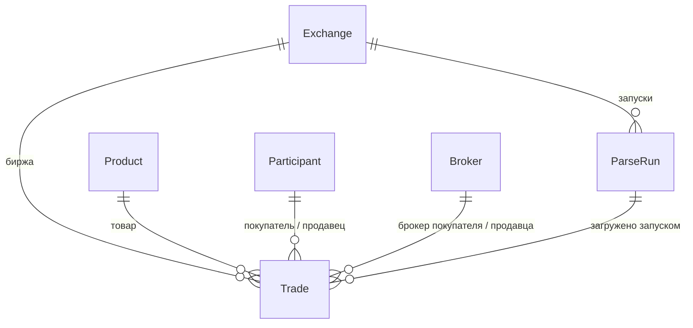

# Структура базы данных

СУБД: SQLite (по умолчанию) или PostgreSQL (через переменные `POSTGRES_*`). Схема создаётся миграциями Django (`exchanges/migrations/`), готовый SQL-дамп с собранными данными — `docs/db/trades_dump.sql`.

## ER-диаграмма

## Таблицы

### exchanges_exchange — биржи
| Поле | Тип | Описание |
|---|---|---|
| code | varchar(20), уникально | `ets`, `caspy` |
| name | varchar(100) | Название |
| website | url | Сайт |

### exchanges_product — товары (справочник)
| Поле | Описание |
|---|---|
| name | Наименование (русская часть) |
| code | Код товара биржи (индекс) |
| tnved | Код ТН ВЭД ЕАЭС |

Уникальность: `(name, code, tnved)`.

### exchanges_participant — покупатели и продавцы (справочник)
| Поле | Описание |
|---|---|
| name | Наименование (нормализованное) |
| bin | БИН (12 цифр), если указан; индекс |

Уникальность: `(name, bin)`. При загрузке участник с БИН ищется по БИН.

### exchanges_broker — брокеры (справочник)
`name` — наименование, уникально.

### exchanges_parserun — журнал запусков парсера
| Поле | Описание |
|---|---|
| exchange | Биржа |
| started_at / finished_at | Время запуска и окончания |
| status | `running`, `success`, `partial`, `failed` |
| trigger | `manual` (вручную или кнопкой) / `schedule` |
| date_from / date_to | Запрошенный период |
| rows_added / rows_skipped | Добавлено новых / пропущено дублей |
| error | Текст ошибок |

### exchanges_trade — итоги торгов (единый формат обеих бирж)
| Поле | Описание |
|---|---|
| exchange, product, buyer, seller, buyer_broker, seller_broker | Ссылки на справочники |
| trade_date (индекс), trade_time | Дата и время торгов |
| deals_count | Число заключённых сделок |
| quantity, unit | Объём и единица измерения |
| price_open, price_close, price_min, price_max, price_avg | Цены: открытия, закрытия, мин., макс., средневзвешенная |
| price_with_vat, price_without_vat | Цена с НДС и без НДС (если биржа указывает) |
| amount (индекс) | Сумма сделки, тг |
| delivery_basis, delivery_place, delivery_term | Базис, место и срок поставки |
| source_url | Ссылка на файл/страницу источника |
| source_key, уникально | sha1-отпечаток строки — защита от дублей |
| parse_run | Запуск, который загрузил запись |

Индексы: `(exchange, trade_date)`, `trade_date`, `amount`, `delivery_place`, наименования справочников, `product.code`, `participant.bin`.

## Какие поля есть на какой бирже

| Поле | ETS | Каспий |
|---|---|---|
| Дата торгов | да | да |
| Время торгов | нет | нет |
| Покупатель, продавец, БИН | да (в файлах 2025 года нет БИН) | да |
| Брокеры | да (в файлах 2025 года нет) | да |
| Объём, единица измерения | нет | нет (есть только в запасном JSON) |
| Цены (открытие/закрытие/мин/макс) | да | да |
| Средневзвешенная цена | да | да |
| Цена с/без НДС | нет | нет (есть только в запасном JSON) |
| Сумма сделки | да (в файлах 2025 года нет) | да |
| Базис поставки | из названия товара (EXW, FCA…) | да |
| Место поставки | нет | нет (есть только в запасном JSON) |
| Срок поставки | нет | нет |

Пустые значения хранятся как NULL / пустая строка и в портале показываются как «—».
